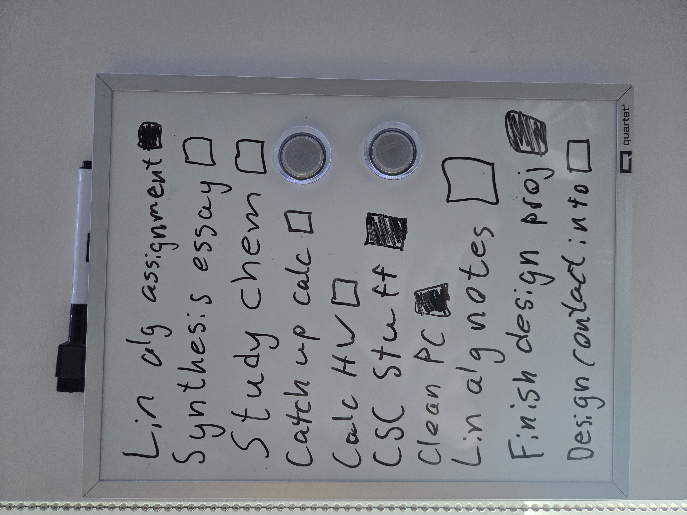

# SP-Image-Sync

Snap a photo of your handwritten to-do list and sync it into [Super Productivity](https://github.com/super-productivity/super-productivity). SP Image Sync sends the image to Gemini to extract task titles and checkbox states, diffs the result against your existing tasks, and applies the changes after you confirm.

## How it works

1. You point it at an image of a whiteboard with a checklist (empty box = not done, filled box = done).
2. Gemini reads the image and extracts each task's title and status.
3. The tool fetches your current tasks from a local Super Productivity API and builds a sync plan:
   - **Add** — whiteboard tasks marked not-done with no matching task
   - **Complete** — open tasks whose whiteboard match is now checked off
   - **Reopen** — tasks that are done in the tracker but unchecked on the whiteboard
4. The plan is printed for review, and applied only after you confirm (or never, with `--dry-run`).

Matching is done by normalizing titles (whitespace stripped, lowercased), so wording has to line up closely between the whiteboard and the tracker.

## Requirements

- Python 3.13+
- [uv](https://docs.astral.sh/uv/)
- Super Productivity app running with its local REST API turned on (Settings → Misc → Enable local REST API)
- A Gemini API key

## Setup

```bash
uv sync
cp .env.example .env
```

Edit `.env` and fill in:

```
SP_TOKEN=<Super Productivity access token (same settings section where you enabled the REST API)>
GEMINI_API_KEY=<your Gemini API key>
```
`GEMINI_API_KEY`: get one from [Google Ai Studio](https://aistudio.google.com/)

Note: Free tier Gemini requests may be used by Google to improve their models.

## Usage

```bash
uv run sp-image-sync path/to/whiteboard_example.jpg
```

Use `--dry-run` to print the sync plan without prompting or applying it:

```bash
uv run sp-image-sync path/to/whiteboard_example.jpg --dry-run
```



Example output:

```
ADD: Design contact info
COMPLETE: Finish design proj
REOPEN: Synthesis essay
REOPEN: Calc HW
```

If nothing changed, it just prints `Nothing to sync`.

## Design decisions

- **The whiteboard is the source of truth.** Sync is one-way: whiteboard → SP. If SP and the whiteboard disagree about a task's status, SP is changed to match the whiteboard. Consequence: if you complete something in SP directly instead of on the whiteboard, the next sync will reopen it, since as far as the whiteboard is concerned it's still open.
- **`plan_sync` is a pure function.** It takes whiteboard items and SP tasks as plain data and returns a `SyncPlan`, no SP client, no Gemini client, no I/O. That's what lets the test suite cover matching, duplicates, and normalization without Super Productivity running or a Gemini API key.
- **Reruns are safe.** Nothing is tracked between runs; each sync recomputes the plan from whatever SP and the whiteboard currently look like. Running the same image twice (or re-running after declining or partially applying a plan) just reflects what's still mismatched; already-synced items produce no further action.

## Limitations

- **Same machine only.** The tool talks to SP's local REST API on `127.0.0.1`, so it has to run on the same machine Super Productivity is running on.
- **CLI only.** There's no GUI; you run it from a terminal and confirm the plan at a prompt.
- **Duplicate titles are handled conservatively.** If several SP tasks share a normalized title, checking that title done on the whiteboard completes every open duplicate, but unchecking it reopens only one of the done duplicates.

## Development

```bash
uv run pytest       # tests
uv run ruff check   # lint
uv run pyright       # type check
```

## Roadmap

- A phone app, so you can snap the whiteboard photo and sync directly from your phone instead of transferring it to the machine running SP.

## License

MIT — see [LICENSE](LICENSE).
